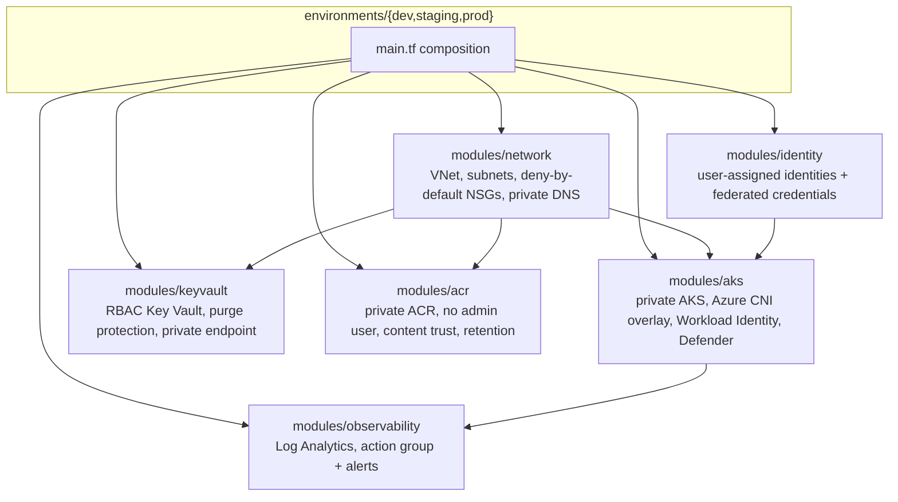
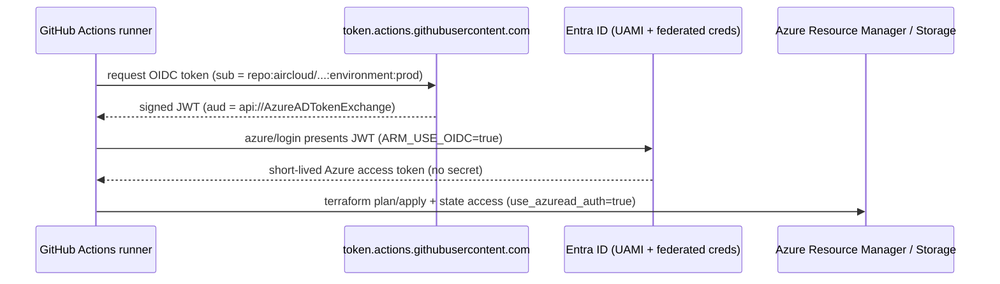
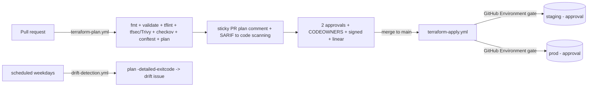

# Architecture

`template-terraform-azure` provisions a private AKS platform on Azure with keyless,
OIDC-based CI/CD. This document covers the topology, the OIDC trust model, the state
backend, and how a change flows from PR to apply.

## Module composition

Each environment is an independent composition with its **own remote-state key**
(`dev.terraform.tfstate`, `staging.terraform.tfstate`, `prod.terraform.tfstate`) so blast
radius is contained per environment.

## OIDC trust model (keyless)

No client secrets exist anywhere. GitHub Actions exchanges a short-lived OIDC token for an
Azure access token against a user-assigned managed identity that trusts specific repo
subjects (federated credentials created by `bootstrap/scripts/01-github-oidc.sh`).

Federated credential subjects provisioned by bootstrap:

| Subject | Used by |
| --- | --- |
| `repo:aircloud/template-terraform-azure:pull_request` | `terraform-plan.yml` |
| `repo:aircloud/template-terraform-azure:environment:dev` | `terraform-apply.yml` (dev) |
| `repo:aircloud/template-terraform-azure:environment:staging` | `terraform-apply.yml` (staging) |
| `repo:aircloud/template-terraform-azure:environment:prod` | `terraform-apply.yml` (prod) |

`AZURE_CLIENT_ID`, `AZURE_TENANT_ID`, `AZURE_SUBSCRIPTION_ID` are GitHub **variables**
(non-sensitive identifiers), not secrets.

## Remote state

State lives in an Azure Storage account bootstrapped by
`bootstrap/scripts/00-state-storage.sh`:

- Account `staircloudtfstate`, resource group `rg-aircloud-tfstate`, container `tfstate`.
- Entra-ID-only auth (`use_azuread_auth = true`), shared-key access disabled, TLS 1.2+,
  public blob access off, blob versioning + 30-day soft delete.
- The CI identity needs `Storage Blob Data Contributor` on the state container.
- Native blob lease locking prevents concurrent writes; `-lock-timeout=120s` in CI.

## Change flow

See [BRANCH-PROTECTION.md](BRANCH-PROTECTION.md) for the ruleset and required checks, and
the repository [README](../README.md) for the CI/CD table and quick start.

## Security posture summary

- Private AKS API server; Workload Identity; Azure RBAC; Microsoft Defender for Containers.
- RBAC-only Key Vault with purge protection and a private endpoint.
- Private ACR with `admin_user` disabled, content trust and retention.
- Deny-by-default NSGs; private DNS zones for private endpoints.
- Supply chain: SHA-pinned actions, harden-runner egress control, SBOM (CycloneDX), keyless
  cosign signing, build-provenance attestation, OpenSSF Scorecard, gitleaks, CodeQL, Semgrep.
